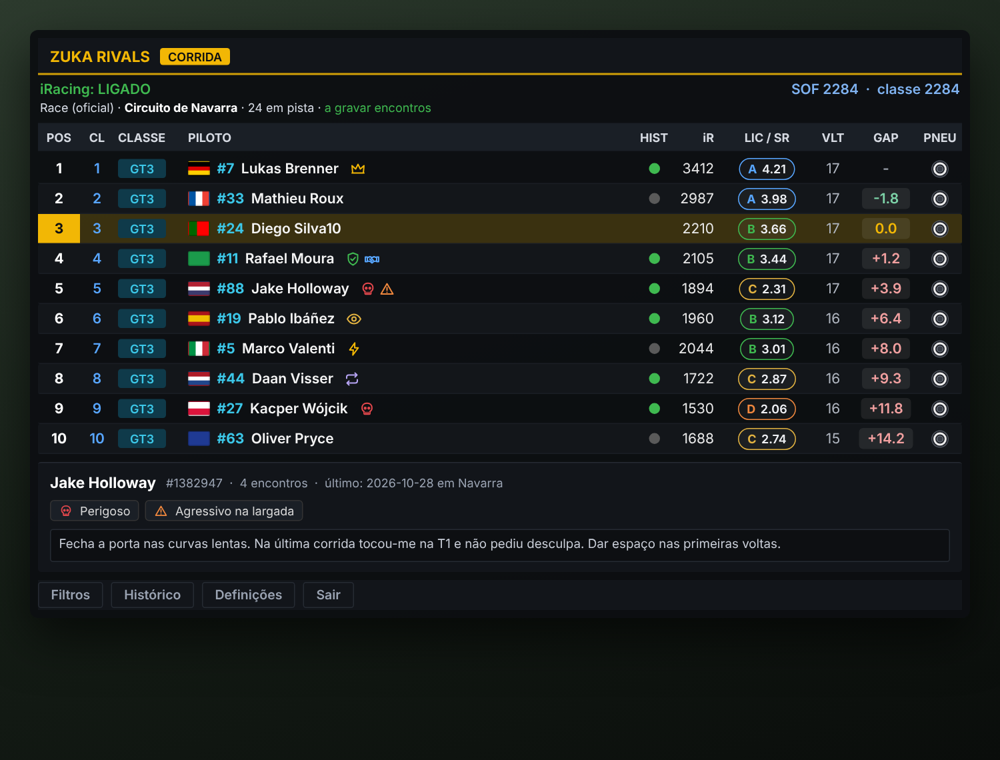

<p align="center">
  
</p>

<h1 align="center">Zuka Rivals</h1>

<p align="center">
  <b>A free live overlay for iRacing that remembers every driver you have ever raced against.</b>
</p>

<p align="center">
  
  
  
  
  
</p>

<p align="center">
  <br>
  <sub>Illustrative preview with fictional drivers. Real in-game screenshots are welcome via pull request.</sub>
</p>

---

## Why this exists

Zuka Rivals started as an **experiment**.

I wanted a **history of the drivers I have already raced against**: who was clean, who was reckless, who I should give extra room to on lap one. And I wanted it **without paying for third-party services**.

So I built it, locally, on my own PC. Your history lives in a small database on your computer, you tag drivers with simple icons, you write notes, and the next time you meet them in a grid, the overlay tells you before the lights go out.

> **A personal note:** this is the **first program I ever built with the help of Claude** (Anthropic's AI assistant). Please expect a few rough edges. That said, as far as I have tested it, it has been working really well. Feedback and issues are very welcome.

## Features

**Live overlay**
- Always-on-top, borderless overlay for the iRacing session, with a **click-through** mode so your mouse goes to the game.
- Live positions and gaps in races; best lap, last lap and delta in practice and qualifying (purple = best of class).
- **Class detection** with a color per car class, class position, and a **strength-of-field (SOF)** figure for the grid and your class.
- iRating, license class and Safety Rating in a single color-coded badge, country flags, car numbers, and a **tyre icon** (dry / intermediate / wet).
- Automatic mode switching: **Race**, **Qualifying** or **Practice**.
- **Danger radar:** drivers tagged Dirty, Aggressive or Unpredictable are highlighted in red and announced in the header when they are within a few seconds of you.
- After the chequered flag the list is **kept** (drivers who leave are dimmed), with an optional auto-remove timer.

**Driver memory**
- Every driver is stored by their **iRacing Customer ID**, so name changes do not break the history.
- A small dot shows whether you have **raced them before** (and how many times).
- **Tags** with clean vector icons (skull, warning, shield, crown, handshake and more) plus your own custom tags, and free-text **notes** per driver.
- **Search your history** for drivers who are no longer in the session, to add tags or notes afterwards.
- Filters by name, history, tag and class.
- **Head-to-head:** for each driver you can see in how many official races you finished ahead of or behind them.
- Only **official races** are recorded as encounters. Practice and unofficial sessions do not count.

**Make it yours**
- **5 layout themes:** Pit Wall, Cards, Tower, HUD and Telemetry.
- Custom **accent, background and header colors**, plus sliders for opacity, font size and row height.
- Compact mode, adjustable columns that adapt when you resize the window, global hotkeys (`Ctrl+Alt+O` show/hide, `Ctrl+Alt+C` click-through), and optional start with Windows.
- Interface in **Portuguese, English, Spanish and French**.

**Your data stays yours**
- Daily automatic backups (the last 10 are kept), an optional extra backup folder (for example OneDrive), and export/import to move your history to another PC.

## Install

1. Go to [**Releases**](../../releases) and download `ZukaRivals-Setup-x.y.z.exe`.
2. Run it and follow the wizard: choose the folder, and whether you want a desktop shortcut.
3. Start **Zuka Rivals** from the Start menu or the desktop and open iRacing. The overlay appears when a session is running.

If Windows says you have no permission, you probably picked `Program Files` without administrator rights: keep the suggested folder, or choose "Install for all users" when the installer starts.

The installer includes everything the program needs (the .NET runtime included), does not ask for administrator rights by default, and adds a normal entry to **Windows Settings > Apps**, so you can uninstall it cleanly. On uninstall it asks whether you also want to delete your history and settings.

### About the Windows security warning

The installer is **not code-signed yet**. Code-signing certificates are paid, and this is a free hobby project, so Windows may show **"Windows protected your PC"** or **"Unknown publisher"** the first time. If that happens, choose **More info > Run anyway**.

**Windows 11 Smart App Control.** If Smart App Control is on, Windows can block an unsigned installer outright ("Error 4551: an Application Control policy has blocked this file") and there is no "Run anyway" button. This is a limit of unsigned software, not a fault in the program. The fix is a code-signing certificate (being looked into, including free signing for open-source projects). Until then, the program cannot run on PCs where Smart App Control or a company policy blocks unsigned apps, unless that protection is changed by the user.

I understand that is not ideal, so here is how you can verify what you are installing:

- Everything is **open source**. The `.exe` and the installer are built in public by GitHub Actions from this code, with no obfuscation. See [`.github/workflows/instalador.yml`](.github/workflows/instalador.yml).
- Each release includes **`SHA256.txt`** so you can compare the checksum of your download (`Get-FileHash .\ZukaRivals-Setup-1.0.0.exe` in PowerShell).
- You can upload the installer to [VirusTotal](https://www.virustotal.com) before running it.
- The program has **no network code at all**. It does not upload, download or phone home. See [`SECURITY.md`](SECURITY.md).

## Privacy

- The overlay reads iRacing's **shared memory and session data**, read-only.
- Your history, tags, notes and settings are stored **locally** in `%AppData%\iRacingTracker`.
- Nothing is sent anywhere. There is no telemetry, no account and no internet connection.

## Build from source

You need the [.NET 10 SDK](https://dotnet.microsoft.com/download) on Windows.

```powershell
git clone <this repository>
cd <folder>
dotnet run                                          # run it
dotnet publish -c Release -o publish                # self-contained ZukaRivals.exe in .\publish
```

The installer is an [Inno Setup](https://jrsoftware.org/isinfo.php) script in [`installer/ZukaRivals.iss`](installer/ZukaRivals.iss). Pushing a tag such as `v1.0` makes GitHub build and attach it automatically.

**Tech:** C# / WPF (.NET 10), the iRacing shared-memory SDK, SQLite through the Windows built-in `winsqlite3`. No third-party NuGet packages.

## Quality and review

- CI builds every push and runs a script that fails on antivirus-sensitive patterns (network code, dynamic code loading, global input hooks, hidden PowerShell, binaries in the repo).
- **CodeQL** scans the C# code weekly and on every pull request.
- A review agent definition lives in [`.claude/agents/revisor-zuka-rivals.md`](.claude/agents/revisor-zuka-rivals.md) for security and simplification reviews.

## Roadmap

Ideas for future versions (no promises):
- Support for other sims, starting with **Le Mans Ultimate**, then **Assetto Corsa Competizione**.
- A signed installer, or a Microsoft Store package, to remove the SmartScreen warning.
- Post-race review and an incidents column.

## Contributing

Bug reports, screenshots and suggestions are welcome through [Issues](../../issues). If you open a pull request, please keep the project dependency-free and network-free.

## License

Released under the [MIT License](LICENSE).

## Disclaimer

Zuka Rivals is an independent, community project. It is **not affiliated with, endorsed by or sponsored by iRacing.com Motorsport Simulations**. *iRacing* is a trademark of its respective owner. The program only reads data that the simulator itself exposes locally, and does not modify the game in any way.

---

<p align="center">Built by <b>Zuka</b> (<a href="https://www.youtube.com/@OptimusZuka">OptimusZuka</a> on YouTube), with a lot of help from Claude. 🏁</p>
